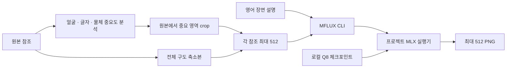

# 설계

Imagen은 모델 학습이나 체크포인트 재양자화를 수행하지 않는다. 설치된 MFLUX 위에 입력 준비와 프로젝트 전용 실행 최적화를 연결한다.

## 경계

| 경로 | 책임 |
|---|---|
| `generate.sh` | 모델 위치·출력 설정을 읽고 Python 진입점 호출 |
| `scripts/python.sh` | 설치된 MFLUX의 Python 환경을 사용 |
| `src/imagen/references/reference_policy.py` | 입력·출력·참조 개수·추가 토큰의 공통 제한 |
| `prepare_references.py` | 방향 보정, crop 후 축소·패딩, 원본 보존, 기록 |
| `auto_regions.py` | 후보 점수·겹침·다양성·예산 제어 |
| `detect_regions.swift` | macOS Vision 분석; 위치와 신뢰도만 반환 |
| `launch_generation.py` | 참조 역할 설명·오프라인 CLI·런타임 게이트 |
| `src/imagen/runtime/` | MFLUX 클래스의 프로젝트 프로세스 내 패치 |

자동 분석 프로세스는 MFLUX 생성 프로세스가 시작되기 전에 끝난다. 생성 시점에는 각 입력이 512 이하인 준비된 PNG만 전달된다. 원본 경로나 OCR로 읽은 글자가 프롬프트 지시로 추가되지 않는다. 로컬 참조 기록에는 원본 경로와 해시가 포함되므로 `outputs/`는 Git에서 제외한다.

## 실행 최적화와 입력 최적화

실행 최적화는 같은 텐서 계산을 더 빠르게 수행하는 계층이다. 입력 최적화는 전체 참조를 작은 구도 참조와 고해상도 디테일 참조로 나누는 계층이다. 후자는 정보의 배분과 출력에 영향을 준다. 두 효과를 같은 종류의 벤치마크로 합산하지 않는다.

런타임 모듈의 기존 파일명과 수치 연산은 측정 때의 바이트를 유지했다. `gaon_` 접두사는 기존 커널 모듈 이름이다. 프로젝트 외부의 설치된 MFLUX 소스와 디스크 체크포인트는 수정하지 않는다. `IMAGEN_RUNTIME=0`이면 게이트를 끄고 native MFLUX 클래스를 사용한다.

## 범위

검증한 실행 단위는 매 호출 새 프로세스로 실행하는 CLI다. 상주 서버에서 준비된 모델의 해상도를 계속 바꾸거나, 체크포인트를 다시 저장하거나, 노출하지 않은 LoRA 조합을 적용하는 경로는 현재 설계 범위에 포함하지 않는다.

출력·입력 크기 정책은 [사용법](usage.md), 선택 로직은 [자동 참조](automatic-references.md), 측정은 [벤치마크](benchmarks.md)를 참고한다.
