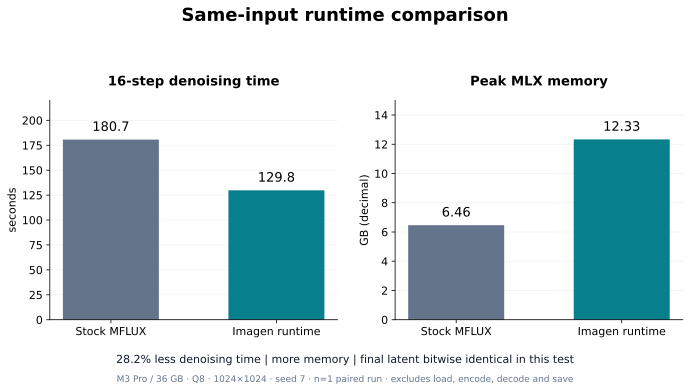
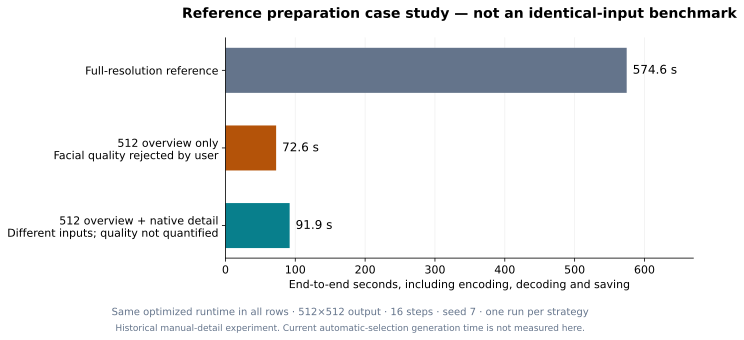

# 벤치마크와 측정 한계

현재 C++ 편집 벤치마크는 [최적화 실험 정리](optimization-experiments.md)를 참조한다.

이 문서의 수치는 C++ 전환 전 Python 실행기의 기록이다. 현재 C++ 실행기의 성능 수치로 사용하지 않는다.

## 1. 같은 입력의 실행기 비교



| 조건 | 값 |
|---|---|
| 장치 | Apple M3 Pro, 통합 메모리 36GB |
| 모델 | 같은 FLUX 3 Image Klein Q8 체크포인트 |
| 소프트웨어 | MFLUX 0.24.0, 커밋 `8a7fd0a486635f670ef90e02efe1c051ed3f133c`; MLX/MLX Metal 0.32.4 |
| 입력 | 같은 저장된 프롬프트 임베딩과 잡음, 1024×1024, 시드 7 |
| 스케줄 | 16스텝, MLX 할당 캐시 제한 1GB |
| 표본 | 각 경로 1회인 통제된 쌍 비교 |
| 측정 구간 | 첫 lazy 가중치 준비를 포함한 16스텝 계산 |
| 제외 | 모델 생성·로딩, 프롬프트 인코딩, VAE 디코딩, PNG 저장 |

| 항목 | 원본 MFLUX | Imagen 실행기 |
|---|---:|---:|
| 계산 시간 | 180.6977초 | 129.7889초 |
| 피크 MLX 할당 메모리 | 6.4640GB | 12.3314GB |
| 최종 FP32 잠재 텐서 | 기준 | 524,288개 값 비트 동일 |

시간 감소는 **28.17%**, 속도 비율은 약 **1.39배**다. 첫 가중치 준비 약 0.64초가 최적화 시간에 포함됐다. 더 많은 메모리를 사용하며 GB는 10⁹바이트다. 이 메모리는 MLX가 추적하는 계산 구간의 피크로, 전체 시스템 RAM이나 모든 CLI 단계의 합계가 아니다.

122개 직접 커널 검사와 합성 참조 전환 검사도 원본과 수치가 같았다. 육안 품질 평가나 전체 프롬프트 집합의 동등성 검증은 아니다. 추가 과거 실행의 178.9초·135.5초는 다른 중간 버전 기록이므로 차트의 최종 쌍에 섞지 않았다. 오류가 있던 초기 173초 기록도 제외했다.

[원시 기록](../benchmarks/data/runtime-2026-10-28.json)의 경로·코드 해시는 측정 당시 레이아웃을 가리킨다. 당시 Python 런타임 소스는 Git 커밋 `15b8bf1`에서 확인할 수 있다. 현재 C++ 실행과 동일한 환경이라는 뜻은 아니다.

## 2. 참조 준비 전략 사례



| 구성 | 전체 시간 | 참조 토큰 | 판단 |
|---|---:|---:|---|
| 원본 2048×1365 전체 | 574.56초 | 11,008 | 비교 시작점 |
| 512 전체 구도 참조만 | 72.58초 | 704 | 사용자가 얼굴 왜곡으로 거부 |
| 512 전체 구도 + 원본 세부 참조 | 91.93초 | 1,302 | 입력·출력 달라짐, 화질 정량 평가 없음 |

같은 최적화 실행기·Q8·512×512 출력·16스텝·시드 7을 사용했다. 전체 시간에는 입력 준비, 모델 로딩, 인코딩, 디노이징, 디코딩과 저장이 포함된다. 원본 전체 대비 세부 참조 전략의 시간 비율은 약 6.25배지만 **입력이 바뀐 사례**다. 앞 절의 1.39배 실행기 가속과 곱하거나 합산하지 않는다.

이 사례는 수동 디테일 지정으로 측정했다. 자동 분석 전처리의 성능 검사는 별도로 있으며, 현재 자동 정책의 같은 사진에 대한 전체 생성 A/B 측정은 없다. 이전 별도 얼굴 도구의 91.00초도 [기록](../benchmarks/data/historical-detail-2026-10-28.json)으로 남겼지만 현재 정책의 보편적 성능으로 사용하지 않는다.

원본 사진·사용자 경로·사진 파일 해시는 배포하지 않는다. 숫자 조건은 [공개 사례 데이터](../benchmarks/data/reference-edit-2026-10-28.json)에 남겼다. 원본 사진이 없으므로 이 역사적 사례를 픽셀까지 재현할 수는 없다.

## 3. 현재 자동 정책의 실제 작업 시간

| 작업 사례 | 출력 | 자동 세부 참조 | 전체 시간 |
|---|---:|---:|---:|
| 물체 제거 | 384×512 | 0 | 63.94초 |
| 눈 편집 | 336×512 | 2 | 120.27초 |
| 눈 편집, 지시 수정 | 336×512 | 2 | 117.74초 |

서로 다른 사진·프롬프트·출력 크기다. 사용감의 사례이며 controlled A/B나 평균은 아니다. 사진·프롬프트가 달라지면 자동 선택 수와 연산량도 달라진다.

자동 선택 전처리 자체는 준비된 시스템에서 사례별 약 0.49~0.81초였고 최초 OS 분석기 초기화에는 약 15~17초가 관찰됐다. 생성 전체와 구분한다. [자동 선택 검사 기록](../benchmarks/data/automatic-selection-2026-10-28.json)

## 재현과 그래프

과거 Python 비교의 실행기와 재현 도구는 Git 커밋 `15b8bf1`에 보관되어 있다. 현재 C++ 결과와 조건은 [최적화 실험 정리](optimization-experiments.md)를 참조한다.

차트는 원시 JSON에서 재생성한다.

```sh
uv run --no-project --python 3.12 --with matplotlib==3.10.7 \
  python scripts/render_benchmarks.py
```

막대그래프 축은 0에서 시작하고, 서로 다른 측정 구간은 별도 차트로 표시한다. 표본이 한 번이라 오차 막대나 통계적 신뢰 구간은 만들지 않았다. 다중 프롬프트 품질 평가, 여러 Mac의 성능 비교, 반복 측정에 따른 분포는 아직 없다.
